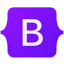
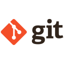
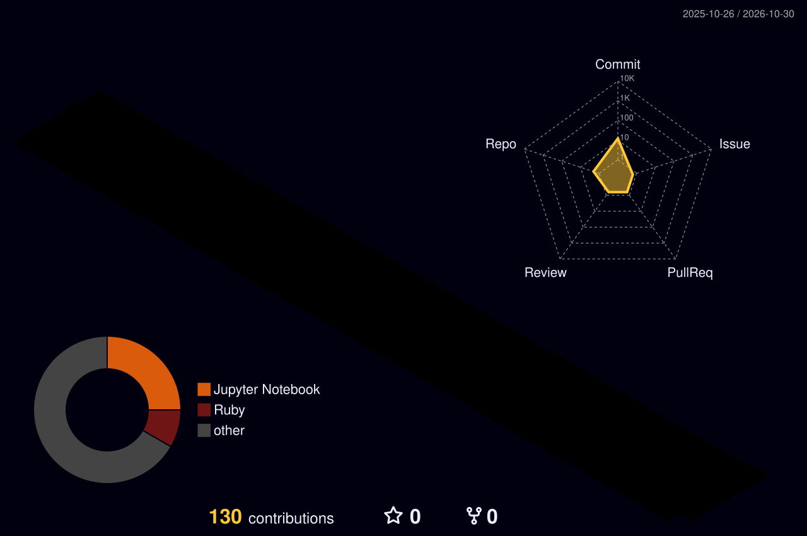

  <h1>Hi there, I'm Abdullah Tariq 👋</h1>

<i>Crafting Clean, Maintainable, and Scalable Web Applications</i>

<picture>
  <source media="(prefers-color-scheme: dark)" srcset="https://raw.githubusercontent.com/abdullahtariqlatif/abdullahtariqlatif/output/github-contribution-grid-snake-dark.svg" />
  <source media="(prefers-color-scheme: light)" srcset="https://raw.githubusercontent.com/abdullahtariqlatif/abdullahtariqlatif/output/github-contribution-grid-snake.svg" />
  
</picture>

## 👨‍💻 About Me

I'm a Full-Stack Software Engineer with experience building and maintaining production
applications in **Ruby on Rails** and the **MERN stack** (React, Node.js, Express, MongoDB),
across healthcare, legal tech, logistics, e-commerce, and media.

- 🏗️ Backend systems, APIs, and admin dashboards, end to end - from greenfield builds to
  refactoring legacy codebases.
- 🏥 Migrated telemedicine platforms to AWS Chime (background blur/replacement, recording,
  multi-participant sessions).
- 🤖 Automated legal form submissions with Selenium, and built automation pipelines for
  publishing and LinkedIn integrations.
- 🌱 Currently expanding into n8n workflow automation, AI-assisted development, and Python for
  data analysis.
- 🎮 Outside of code: an avid gamer and hardware enthusiast.

## 🛠️ Tech Stack

<table width="80%">
<tr>
    <td align='center' width="120"></td>
    <td align='center' width="120"></td>
    <td align='center' width="120"></td>
    <td align='center' width="120"></td>
    <td align='center' width="120"></td>
</tr>
<tr>
    <td align='center' width="120"></td>
    <td align='center' width="120"></td>
    <td align='center' width="120"></td>
    <td align='center' width="120"></td>
    <td align='center' width="120"></td>
</tr>
<tr>
    <td align='center' width="120"></td>
    <td align='center' width="120"></td>
    <td align='center' width="120"></td>
    <td align='center' width="120"></td>
    <td align='center' width="120"></td>
</tr>
<tr>
    <td align='center' width="120"></td>
    <td align='center' width="120"></td>
    <td align='center' width="120"></td>
    <td align='center' width="120"></td>
    <td align='center' width="120"></td>
</tr>
</table>

## 📊 GitHub Stats

Stats and Languages below only see public repos (third-party widgets, no private-repo access) - see the Activity badges below for accurate commit/streak figures.

|Stats|Languages|
|---|---|
|||

## ⚡ Activity

<!--COMBINED-STATS:START-->

last updated 2026-10-29

<!--COMBINED-STATS:END-->

## 📌 Featured Repos

| Project | Language | Last Commit |
|---|---|---|
| [**handy_programs**](https://github.com/abdullahtariqlatif/handy_programs) |  |  |
| [**rails_vault**](https://github.com/abdullahtariqlatif/rails_vault) |  |  |
| [**WebWithAI-Batch-09**](https://github.com/abdullahtariqlatif/WebWithAI-Batch-09) |  |  |
| [**practice_programs**](https://github.com/abdullahtariqlatif/practice_programs) |  |  |

## ⚡ Isometric View of Contributions

## 🚀 GitHub Metrics

## 🏆 Trophies

 

  

